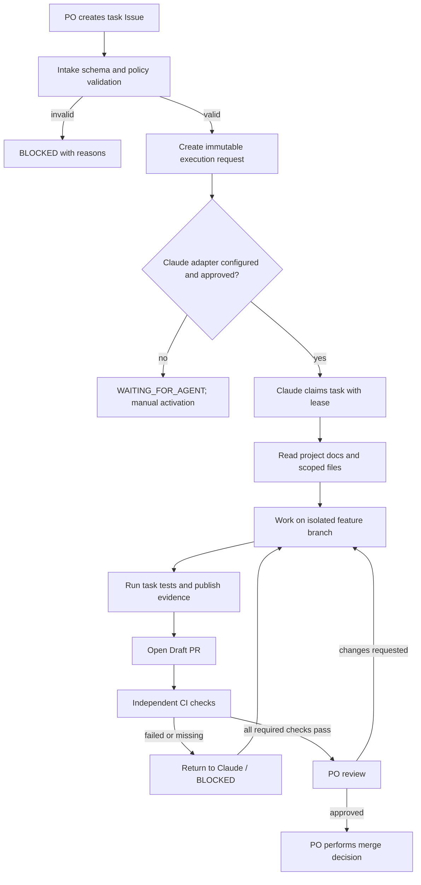

# AI Orchestration Technical Design v1 — TuTienGioi

- Status: PROPOSAL — documentation only; not an implementation authorization.
- Date: 2026-11-27
- Owner: Product Owner
- Scope: GitHub task intake → Claude task execution → Draft PR → CI → Product Owner approval.
- Safety baseline: no Production, no real TikTok LIVE, no paid services/spend, no secret exposure, no automatic merge.

## 1. Executive decision

Build a provider-neutral orchestration contract with a Claude executor adapter. Keep the adapter in MANUAL / NOT_CONFIGURED state until a separately approved integration proves it can invoke the user's authorized Claude Code environment safely and within the 0-VND project budget.

GitHub Actions is the control plane, not the AI runtime. A workflow that validates an Issue, uploads a packet, or writes a manifest has NOT invoked Claude. The current repository workflows explicitly state this limitation.

Project AI roster for this design is limited to:
- ChatGPT: Product Owner-facing planner, dispatcher, and independent acceptance reviewer.
- Claude: technical task executor and technical reviewer when explicitly assigned.

Do not route tasks to Copilot, DeepSeek, or any additional AI/worker.

## 2. Verified current-state constraints

1. `.github/workflows/ai-task-dispatch.yml` validates task headings and posts an issue comment. It explicitly says it does not wake/invoke a Claude session.
2. `.github/workflows/agency-execution-bridge.yml` creates an execution packet only. It explicitly says no external AI session is invoked and is gated by `vars.AGENCY_CI_ENABLED == 'true'`.
3. `.github/workflows/agency-native-trigger-gate.yml` creates a manifest only; `trigger_gate.py` returns `invoked: false`. It is not a Claude executor.
4. `scripts/agency/prepare_execution.py` emits `PREPARED_NOT_TRIGGERED` and enforces worker enabled state.
5. `scripts/agency/trigger_gate.py` currently supports only a GitHub Copilot adapter identifier; this design does not enable or extend it.
6. `scripts/agency/workers.json` currently has Claude disabled and says no external session trigger is wired. Do not flip this flag as a substitute for implementing an adapter.
7. `00_PROJECT/AI_ORCHESTRATION.md` describes the shared task lifecycle and explicitly says an orchestration runner/adapters are required for autonomous wake-up.
8. PR #36 remains an independent Draft and is outside this proposal.

## 3. Goals and non-goals

### Goals
- One canonical GitHub Issue per task, with schema validation and auditable state transitions.
- Exactly one executor claim per task; duplicate events must be idempotent.
- Claude receives only the scoped task packet and permitted repository context.
- Execution occurs on a dedicated feature branch, never directly on main.
- Claude submits a Draft PR with changed paths, test evidence, risks, and rollback notes.
- CI independently verifies the proposed change.
- Product Owner approval remains the only merge authorization.
- Every step is traceable to Issue, run, actor, branch, commit, PR, and evidence.

### Non-goals
- No autonomous merge, release, deployment, production data access, or real TikTok connection.
- No automatic changes to approved gameplay decisions or GDD.
- No paid API, subscription, runner, storage, or other project spend.
- No sharing Claude credentials, browser cookies, personal tokens, or long-lived secrets in task packets.
- No new AI worker or parallel edit ownership for the same files.

## 4. Target architecture

### Components
1. **GitHub Issues — task queue and source of truth.** The Issue contains the approved task contract and current status.
2. **Intake validator — GitHub Actions.** Validates schema, labels, assigned AI, allowed mode, scope, acceptance criteria, tests, dependencies, and safety flags. Invalid tasks fail closed.
3. **Orchestration controller — GitHub Actions plus a future runner/adapter boundary.** Creates an immutable execution request, deduplicates delivery, tracks lease/heartbeat, timeout, retry count, and cancellation.
4. **Claude executor adapter — NOT CONFIGURED.** A separately selected, verified invocation mechanism starts an authorized Claude Code session. Adapter implementation must be selected only after capability, permission, cost, and account-access checks. Until then the only valid result is `WAITING_FOR_AGENT` / manual activation.
5. **Repository workspace.** Claude works on one isolated branch from the expected base SHA and commits only within the Issue scope.
6. **Pull Request — Draft by default.** Includes Issue link, scope summary, tests/results, changed paths, risks, and rollback.
7. **CI quality gate.** Runs required checks on the PR head and reports status to GitHub. A missing check is NOT PASS.
8. **PO approval gate.** Human review and explicit approval before a PR may become ready/merge. Auto-merge remains disabled.

### Logical sequence

## 5. Task contract and state machine

Required Issue fields:
- Task ID (unique and immutable)
- Assigned AI (Claude or ChatGPT; exactly one executor)
- Mode and fallback mode
- Status
- Repository, base branch, expected starting SHA
- Goal and bounded file/module scope
- Explicit out-of-scope list
- Dependencies and upstream artifact references
- Acceptance criteria (testable checkboxes)
- Test commands and required evidence
- Deliverables and rollback notes
- Safety classification: documentation / code / integration; synthetic-only flag where applicable

Allowed statuses:
- `OPEN`: validated and eligible.
- `CLAIMED`: one executor owns a time-limited lease.
- `IN_PROGRESS`: execution started on declared branch.
- `REVIEW`: Draft PR submitted; awaiting CI/review.
- `BLOCKED`: missing permission, dependency, quota, environment, or failed gate.
- `DONE`: accepted by PO with evidence; never inferred from a commit alone.
- `CANCELLED`: explicitly stopped with reason.

Transitions must be explicit and append-only in the audit trail. Reject invalid transitions. Repeated webhook delivery must not create duplicate branches, commits, runs, or PRs.

## 6. Executor adapter contract

The adapter is a replaceable boundary; the workflow must not contain provider-specific assumptions.

Input:
- request_id, issue_number, issue_url
- assigned_ai and exact approved mode
- repository and base_sha
- bounded scope and out-of-scope rules
- acceptance criteria and test commands
- safety policy and expiry/timeout
- idempotency key

Output:
- provider_session_id (opaque, no credential)
- claim status and timestamp
- branch name and starting SHA
- heartbeat / terminal status
- commit SHA(s), PR URL, changed paths
- test results and evidence links
- blocker/error category

Adapter security requirements:
- Use a supported, authorized integration only after verification. Never scrape a browser session or copy a personal access token into an Issue.
- Use short-lived, least-privilege credentials where the selected integration supports them.
- No access to repository/org secrets unless separately approved and strictly required; task execution must not print secret values.
- Restrict writes to task branch/PR creation; do not grant main-branch bypass or merge permission.
- Reject expired, cancelled, duplicate, or out-of-scope requests.
- Log metadata only; never log credentials, cookies, private prompt data unrelated to task, or secret values.

## 7. Permissions and branch policy

Proposed minimum GitHub permissions by stage:
- Intake: `issues: read`; `contents: read`.
- Task status comment: `issues: write` only if required.
- Executor branch commits: `contents: write` limited to the selected integration and isolated branch; no branch protection bypass.
- PR creation: `pull-requests: write`.
- CI: read source and write check results only as required by GitHub Actions.
- Secrets: none by default.

All workflow permissions must be declared explicitly at the narrowest job level. Fork-originated PRs and untrusted Issue text must not receive write credentials. Treat Issue bodies, comments, repository files, and generated artifacts as untrusted input; do not interpolate them into shell commands or executable workflow code.

Branch format: `ai/<task-id>/<short-slug>`. Branch must start from the Issue's expected base SHA; if main has moved, stop and request rebase/revalidation rather than silently changing the base.

## 8. Failure handling and recovery

- Duplicate event: return existing request/claim; do not start a second session.
- Claim collision: first valid lease wins; other attempts receive ALREADY_CLAIMED.
- Lease expiry: mark BLOCKED, preserve branch and artifacts, require explicit retry/reclaim.
- Transient provider/network error: bounded retry with backoff and idempotency; no infinite loop.
- Permanent auth/quota/cost issue: WAITING_FOR_AGENT; do not switch to a paid route.
- CI failure: attach concise failing check/log reference; return task to IN_PROGRESS only after executor reclaims it.
- Scope violation or secret exposure: stop execution, revoke affected short-lived credential if possible, mark SECURITY_BLOCKED, notify PO; do not continue automatically.
- Cancelled task: adapter must stop accepting new work; preserve logs and branch for review.
- Rollback: close/cancel PR and delete only the task branch after PO approval; never delete player data or production resources.

## 9. Kill switch and operational controls

- Global dispatch disabled by default.
- Per-task opt-in and explicit allowed-AI value required.
- Separate controls for intake, executor invocation, PR creation, and merge; merge remains human-only.
- Kill switch must prevent new claims and new provider invocations; it must not erase an in-flight branch or audit history.
- Enforce maximum concurrent tasks = 1 for initial rollout.
- Enforce per-task timeout, bounded retries, and a manual cancellation path.
- No automatic fallback to another AI, paid API, or service.

## 10. Observability and audit

For each request record: request_id, Issue, actor, AI/mode, created/claimed/started/ended timestamps, base SHA, branch, provider session reference (opaque), workflow run, attempt count, state transitions, commit(s), PR, CI check conclusions, reviewer/PO decision, blockers, and cancellation reason.

Never record secret values or personal account tokens. The Issue is the human-readable audit record; workflow artifacts contain only non-sensitive manifests and test evidence with retention limited to the minimum useful period.

## 11. Rollout stages and gates

- **Stage 0 — design (this PR):** documentation only. No automation change.
- **Stage 1 — offline simulation:** fake executor; synthetic Issues; prove validation, idempotency, lease, state machine, kill switch, and Draft PR policy without invoking Claude.
- **Stage 2 — CI-only:** run CI on synthetic PRs; verify missing/failed checks block progression.
- **Stage 3 — manual Claude handoff:** user manually activates Claude from a validated packet; verify claim, branch, PR, CI, and audit end-to-end. No secrets or paid services.
- **Stage 4 — native invocation evaluation:** compare supported Claude Code integration options, access, permissions, quota, and cost. Requires separate PO approval before implementation or enabling.
- **Stage 5 — limited automation:** only after all gates pass and PO explicitly approves; one task at a time, no merge/deploy/real LIVE.

No stage is authorized merely by merging this design document.

## 12. Open decisions (must remain unresolved until evidence/PO approval)

1. Which supported Claude invocation mechanism is available in the user's current account and can operate within the 0-VND constraint?
2. Does that mechanism support short-lived least-privilege repository access and auditable cancellation?
3. Which CI checks are mandatory for each code-risk tier, based on actual package scripts and existing tests?
4. What timeout and retry limits should be adopted after offline simulation measurements?
5. Whether any future runner requires provisioning. Any paid or externally hosted runner is out of scope without PO approval.

## 13. Acceptance definition

The design is accepted when:
- The task schema, state machine, adapter contract, permissions, failure handling, kill switch, audit fields, and rollout gates are unambiguous.
- The test plan in `AI_ORCHESTRATION_TEST_PLAN_V1.md` covers positive, negative, security, idempotency, recovery, and PO approval cases.
- No provider is claimed to be callable until a real invocation test proves it.
- No automation or production behavior is changed by this documentation PR.
