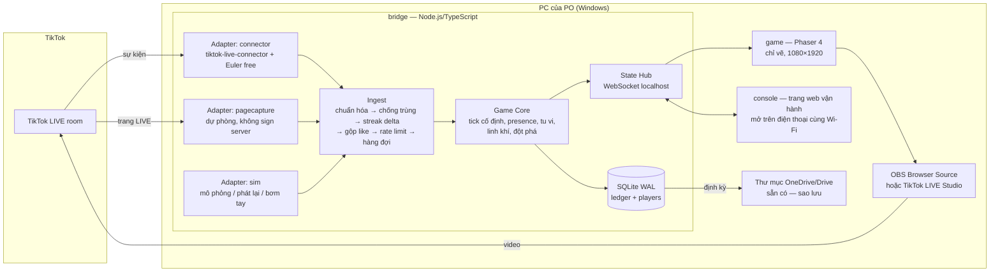

# C-001 — Technical Architecture Proposal (2D/2.5D, 0 VNĐ)

| Mục | Nội dung |
|---|---|
| Task | C-001 / GitHub Issue #1 — Architecture decision review: choose the MVP stack under 0 VND |
| Người viết | Claude — Lead Developer & Technical Architect |
| Người phản biện | ChatGPT — Product Design Lead |
| Người quyết định | Product Owner (WilliamPham0702) |
| Trạng thái | **ĐỀ XUẤT — chờ PO phê duyệt.** Chưa có gì trong tài liệu này là quyết định cuối. |
| Tài liệu nguồn | `PROJECT_BRIEF.md`, `DECISION_LOG.md` (D-001…D-008), `AI_TASK_ASSIGNMENTS.md`, `GDD_v0.1.md` (v0.2), `ART_DIRECTION_BRIEF_v0.1.md`, tại commit `06bf4c1` trên `main` |
| Ngày kiểm tra nguồn | **24/11/2026** (mọi giá, giấy phép, giới hạn miễn phí ở mục 11 đều được tra ngày này) |
| Phạm vi | Chỉ là báo cáo. Không có code triển khai, không có secret, không đăng ký dịch vụ, không sửa tài liệu sản phẩm đã duyệt. |

> **Ghi chú lịch sử:** trước khi PO duyệt D-006 (2D/2.5D) và D-008 (0 VNĐ), Claude từng phác một phương án Web **3D** (Three.js) trong chat. Phương án đó **không còn hiệu lực** và không được dùng trong báo cáo này. Trên `main` chưa từng có file báo cáo kiến trúc nào; đây là bản đầu tiên.

---

## 0. Kết luận một trang

**Phương án duy nhất được khuyến nghị — "Phương án W":**

> **Phaser 4 (TypeScript, WebGL) cho phần hình ảnh 2D/2.5D + Node.js (TypeScript) cho cầu nối LIVE, luật game và lưu trữ SQLite. Chạy hoàn toàn trên PC của PO, đưa vào OBS bằng Browser Source 1080×1920.**

Vì sao chọn phương án này:
1. **AI bảo trì tốt nhất.** Toàn bộ dự án là một ngôn ngữ (TypeScript) và đều là file văn bản. Claude viết, test và review được; PO duyệt qua PR và xem kết quả trên trình duyệt. Phaser 4 còn kèm sẵn bộ "AI agent skills" cho công cụ lập trình AI [S3].
2. **Tích hợp LIVE gọn nhất.** Thư viện cộng đồng phổ biến nhất (`tiktok-live-connector`) viết cho Node.js, nên cầu nối LIVE cùng ngôn ngữ với game. Godot thì cần thêm một tiến trình phụ viết bằng ngôn ngữ khác.
3. **Khung dọc 9:16 dễ nhất.** OBS Browser Source dựng trang ở kích thước tùy ý (1080×1920) mà không phụ thuộc kích thước màn hình. Game dạng cửa sổ (Godot/Unity) muốn có 1920 px chiều cao thì sẽ vượt màn hình 1080p phổ thông, phải xoay màn hình hoặc dùng plugin xuất hình riêng.
4. **0 VNĐ thật:** Phaser là MIT [S1]; Node.js, SQLite, Vite, OBS đều miễn phí.

**Điểm yếu chính của phương án W, nói thẳng:**
- Không có công cụ dựng **skeletal animation** miễn phí, trực quan, tích hợp sẵn như Godot. Spine phải trả phí nên bị loại [S10].
- Animation chibi sẽ làm theo kiểu **cutout bằng dữ liệu**: tách nhân vật thành lớp, mỗi lớp có điểm xoay, keyframe lưu ở JSON và tween trong code; kết hợp sprite sheet cho động tác phức tạp.
- Cách này AI làm được, nhưng **chất lượng phải chứng minh ở PoC-2** (mục 8).
- **Điều kiện chuyển sang Godot 4:** nếu ChatGPT và PO đánh giá animation không đạt chuẩn "chibi tiên hiệp cao cấp". Kiến trúc đã tách sẵn nên đổi phần vẽ không phải viết lại cầu nối LIVE và dữ liệu (mục 4).

**Điểm chấm (thang 100):** Phaser/Web **89,5** · Godot 4 **81,0** · Unity 2D **77,0** (chi tiết mục 2).

**Hai rủi ro có thể làm hỏng mục tiêu, không phụ thuộc engine:**
- (a) **Không có API LIVE chính thức.** Đường miễn phí phụ thuộc thư viện reverse-engineering và sign server miễn phí của bên thứ ba, không có cam kết.
- (b) **Tài khoản TikTok của PO** phải có quyền phát từ PC (LIVE Studio hoặc stream key). Điều này chưa xác minh được.

---

## 1. Yêu cầu rút ra từ tài liệu đã duyệt

| Nguồn | Yêu cầu | Hệ quả kỹ thuật |
|---|---|---|
| D-006, Art Brief | Chibi tiên hiệp cao cấp, nền fantasy nhiều lớp, VFX đẹp; ưu tiên 2D/2.5D | Engine 2D mạnh về sprite, lớp parallax, particle, shader/filter (glow, bloom), animation lớp |
| D-008 | 0 VNĐ chi phí bổ sung | Loại Spine, Phaser Editor (trả phí), API LIVE trả phí, VPS, asset trả phí |
| Brief §4.7 | Ra LIVE nhanh | Ít công cụ, một ngôn ngữ, dựng scene bằng code để AI làm nhanh |
| Brief §5, GDD §10 | Có local simulation; điều khiển vận hành; phục hồi | Lớp adapter có chế độ mô phỏng, phát lại, bơm tay; console vận hành |
| GDD §6 | Rate limit like, chống lạm dụng, không cộng trùng khi reconnect | Ingest có chống trùng, gộp batch, giới hạn tốc độ; sổ cái chỉ ghi thêm |
| Art Brief §6 | 9:16, tên dễ đọc, crowd grouping/culling | Hệ thống "ô hiển thị" có giới hạn, xoay vòng người chơi |
| PO không biết lập trình | Dễ bảo trì cùng AI | Text-first, test tự động, PR nhỏ, ít thao tác editor |

---

## 2. Đánh giá Godot 4 · Phaser/Web · Unity 2D

### 2.1 Tiêu chí và trọng số

Trọng số do Claude đề xuất dựa trên Brief §4 (fast time-to-live) và việc PO không lập trình. PO hoặc ChatGPT có thể đề nghị đổi; mục 2.4 có phân tích độ nhạy.

| # | Tiêu chí | Trọng số |
|---|---|---|
| T1 | Thời gian đến MVP chạy được trên LIVE/OBS | 20 |
| T2 | Chất lượng hình ảnh chibi, nền, VFX, animation | 15 |
| T3 | Xuất 9:16 và đưa vào OBS | 10 |
| T4 | Hiệu năng trên máy tính phổ thông | 10 |
| T5 | Tích hợp sự kiện LIVE, reconnect, dedup, rate limit, mô phỏng | 10 |
| T6 | Lưu tiến trình local và phục hồi | 5 |
| T7 | AI hỗ trợ code/bảo trì cho PO không lập trình | 20 |
| T8 | Vận hành, debug, đóng gói, cập nhật | 5 |
| T9 | Chi phí license/vận hành (0 VNĐ là **điều kiện bắt buộc**; tiêu chí này chấm mức rủi ro phát sinh phí) | 5 |
| | **Tổng** | **100** |

### 2.2 Bảng chấm (1 = kém, 5 = rất tốt)

| Tiêu chí (trọng số) | Phaser 4 + Node (W) | Godot 4.5 (G) | Unity 6 2D (U) |
|---|---|---|---|
| T1 MVP (20) | **5** | 4 | 3,5 |
| T2 Hình ảnh (15) | 3,5 | **4,5** | **4,5** |
| T3 9:16 / OBS (10) | **4** | 4 | 4 |
| T4 Hiệu năng (10) | 4 | **5** | 4,5 |
| T5 Tích hợp LIVE (10) | **5** | 3 | 4 |
| T6 Lưu trữ (5) | **4,5** | 4 | 4 |
| T7 AI bảo trì (20) | **5** | 3,5 | 3 |
| T8 Vận hành (5) | 3,5 | **4,5** | **4,5** |
| T9 Chi phí (5) | **5** | **5** | 4 |
| **Điểm có trọng số /100** | **89,5** | 81,0 | 77,0 |

Cách tính: Σ(trọng số × điểm) ÷ 5. Ví dụ W = (20×5 + 15×3,5 + 10×4 + 10×4 + 10×5 + 5×4,5 + 20×5 + 5×3,5 + 5×5) ÷ 5 = 447,5 ÷ 5 = 89,5.

### 2.3 Lập luận cho từng ô điểm quan trọng

**Phaser 4 + Node.js (W)**
- *Giấy phép:* Phaser phát hành theo giấy phép MIT [S1]. Phaser 4.0 ra mắt 10/04/2026; bản mới nhất là 4.1.0 (30/04/2026) [S2].
- *T2 = 3,5:*
  - Mặt mạnh: Phaser 4 có renderer WebGL mới và hệ thống filter hợp nhất, áp được cho mọi đối tượng [S2]. Glow, bloom và particle đủ cho VFX tu tiên.
  - Mặt yếu: thiếu skeletal animation miễn phí có editor. Runtime Spine cho Phaser cần giấy phép Spine trả phí [S10], nên bị loại.
  - Phương án thay thế: cutout theo dữ liệu kết hợp sprite sheet. Đây là lý do W không được 4–5 điểm ở T2.
- *T3 = 4:* OBS Browser Source dựng ở kích thước bất kỳ, rất hợp 1080×1920. Tuy vậy diễn đàn OBS có nhiều báo cáo về giật hoặc tụt fps ở browser source [S13], nên phải đo trong PoC-2. Phương án dự phòng là cửa sổ Chrome 720×1280 + Window Capture.
- *T5 = 5:* `tiktok-live-connector` là thư viện Node [S6]. Cầu nối, luật game và DB chạy chung một runtime, một ngôn ngữ.
- *T7 = 5:* TypeScript là ngôn ngữ AI viết chính xác nhất trong ba lựa chọn. Scene dựng bằng code nên diff rõ ràng. Phaser 4 ship sẵn thư mục `skills/` cho AI agent [S3]. Test chạy bằng Vitest/Playwright không cần editor.
- *T8 = 3,5:* có 2–3 tiến trình (Node, trình duyệt/OBS) thay vì 1 file exe. Cần script khởi động và tự khởi động lại.

**Godot 4.5 (G)**
- *Giấy phép:* MIT, không phí, không royalty [S4].
- *T2 = 4,5:* có sẵn Skeleton2D, Polygon2D deform, AnimationPlayer, GPUParticles2D, shader 2D, ánh sáng 2D, parallax. Đây là công cụ animation 2D miễn phí tốt nhất trong ba lựa chọn. Art Brief cũng đã liệt kê Godot trong nhóm công cụ miễn phí.
- *T4 = 5:* chạy native, nhẹ, ổn định khi capture bằng Game Capture.
- *T3 = 4:* xuất cửa sổ 1080×1920 vượt chiều cao màn hình 1080p. Phải render 720×1280 rồi phóng trong OBS, xoay màn hình, hoặc thêm plugin xuất hình (Spout/NDI miễn phí nhưng là thành phần bên ngoài).
- *T5 = 3:* mình không tìm thấy thư viện TikTok LIVE viết bằng GDScript được duy trì. Thực tế phải chạy **sidecar Node.js hoặc Python** rồi gửi sự kiện vào Godot qua WebSocket. Kết quả là 2 ngôn ngữ và 2 tiến trình, tức kiến trúc gần giống W nhưng thêm một ngôn ngữ.
- *T7 = 3,5:*
  - Scene `.tscn` và script `.gd` là text nên AI sửa được.
  - Nhưng dữ liệu học về GDScript 4 ít hơn TypeScript nhiều, và AI hay lẫn API Godot 3 với Godot 4.
  - Rig xương và chỉnh animation chủ yếu làm bằng tay trong editor, nên PO không tự làm được và AI khó review.

**Unity 6 2D (U)**
- *Giấy phép:* Personal miễn phí cho tổ chức có doanh thu + vốn đến 200.000 USD/năm; vượt mức phải dùng Pro 2.310 USD/năm/seat [S5]. Hiện an toàn cho 0 VNĐ, nhưng Unity đã nhiều lần thay đổi điều khoản giá (ví dụ tăng giá Pro năm 2026 [S5]). Vì vậy T9 = 4.
- *T2 = 4,5:* gói 2D Animation, PSD Importer, Shader Graph và VFX đều mạnh.
- *T5 = 4:* có TikTokLiveSharp (C#/Unity) [S7], cùng loại thư viện không chính thức.
- *T7 = 3:* phụ thuộc nhiều vào Editor; prefab/scene/meta dài và khó review; CI cần kích hoạt license. Unity Editor nặng hàng GB.
- *T1 = 3,5:* nặng nhất trong ba lựa chọn cho một dự án nhỏ.

### 2.4 Độ nhạy của kết quả

- Nếu nâng **T2 Hình ảnh lên 25** và hạ **T7 AI bảo trì xuống 10**: W = **86,5**, G = **83,0**, U = **80,0**. W vẫn dẫn nhưng khoảng cách với G thu hẹp từ 8,5 xuống 3,5 điểm.
- **Kết luận độ nhạy:** lựa chọn giữa W và G phụ thuộc chủ yếu vào việc **animation cutout của W có đạt chuẩn nghệ thuật hay không**. Vì vậy báo cáo đặt **PoC-2 làm cổng quyết định** (mục 8): đạt thì giữ W, không đạt thì chuyển G.

### 2.5 Lý do loại các phương án còn lại

- **Godot 4:** là phương án B mạnh nhất, không bị loại vĩnh viễn. Chưa chọn vì (1) tích hợp LIVE phải thêm sidecar ngôn ngữ khác, (2) AI bảo trì kém hơn, (3) phần animation phải chỉnh tay trong editor, đi ngược mục tiêu "PO + AI". Godot sẽ được chọn nếu PoC-2 không đạt.
- **Unity 2D:** chất lượng hình ảnh tốt nhưng nặng, phụ thuộc editor, AI khó bảo trì, và có rủi ro điều khoản giá trong tương lai. Không có lợi thế nào vượt Godot ở bối cảnh này.
- **Các lựa chọn khác đã cân nhắc:**
  - *PixiJS* (MIT): renderer 2D mạnh nhưng không phải game framework; phải tự làm scene, tween, input. Phaser đã có sẵn.
  - *Three.js 2.5D*: thừa so với 2D và lệch D-006.
  - *Defold*: miễn phí, nhẹ, nhưng cộng đồng và dữ liệu cho AI nhỏ hơn nhiều.

---

## 3. Truy cập sự kiện TikTok LIVE: chính thức và không chính thức

### 3.1 Phân loại

| Nguồn | Loại | Đọc chat/like/quà realtime? | Chi phí | Ghi chú |
|---|---|---|---|---|
| TikTok for Developers (Login Kit, Content Posting, Research API, Mini Games SDK…) | **Chính thức** | **Không** | — | Mini Games chạy bên trong app TikTok, không phân phối như ứng dụng độc lập [S8], không phải lớp phủ LIVE. Mình không tìm thấy API đọc sự kiện LIVE trong tài liệu chính thức. |
| TikTok LIVE Studio | **Chính thức** (phần mềm phát sóng) | Hiển thị alert trên stream, **không cấp dữ liệu cho ứng dụng khác** | Miễn phí | Dùng để **phát**, không dùng để **đọc** sự kiện |
| `tiktok-live-connector` (Node) / `TikTokLive` (Python) | **Không chính thức**, mã nguồn mở | Có | Miễn phí | Reverse-engineering; cần token ký từ sign server Euler Stream; có mức miễn phí theo "community rate limits"; tác giả khuyến cáo không dùng cho production; TikTok có thể đổi giao thức không báo trước [S6][S7]. Giấy phép: **AGPL đã sửa đổi** [S6][S7] |
| Euler Stream sign server (gói Community) | **Không chính thức**, bên thứ ba | (chỉ ký URL kết nối) | Miễn phí có giới hạn: 2.500 request/ngày, 25 cloud WebSocket [S9] | Là phụ thuộc bên ngoài; có thể sập hoặc giới hạn [S11]. **Không đăng ký API key, không nhập thẻ.** |
| Social Stream Ninja (chế độ Standard / page capture) | **Không chính thức**, mã nguồn mở GPLv3 [S12] | Chat: có; like/quà: **chưa xác minh đủ** | Miễn phí | Chế độ Standard tải trực tiếp trang live và hoàn toàn không dùng sign server [S11]. Dùng làm **nguồn dự phòng thứ 2**. |
| Euler Business, tik.tools, TikSync, TikTool… | **Không chính thức**, trả phí | Có | Có phí | **Loại** theo D-008 |

### 3.2 Dữ liệu đọc được và giới hạn kỹ thuật (qua nguồn không chính thức)

| Dữ liệu | Thực tế | Ảnh hưởng thiết kế |
|---|---|---|
| Bình luận | Có: user id, username, nickname, nội dung | Tín hiệu "đang tham gia" tin cậy nhất; dùng cho lệnh chat |
| Like | Theo lô, kèm số lượng. Với stream đông người, sự kiện like không phải lúc nào cũng được TikTok gửi [S14] | Like chỉ là nguồn linh khí phụ, có trần; không thiết kế luật phụ thuộc vào từng lượt like |
| Quà | Có: mã quà, giá trị, số lần lặp (streak). Combo báo tổng cộng dồn trong lúc chạy hiệu ứng nên dễ **cộng trùng** [S15] | Ingest phải tính phần chênh lệch theo streak |
| Người vào phòng | Có sự kiện join; **chưa xác minh** có gửi đủ cho mọi người | PoC-1 đo tỉ lệ |
| Người đang xem | Chỉ có **tổng số** và **danh sách top viewer** [S16]; **không có danh sách đầy đủ, không có sự kiện rời phòng** | **Không đo chính xác được "thời gian xem" của từng người** → xem đề xuất D-008b ở mục 4.4 |

### 3.3 Tài khoản và khu vực Việt Nam

| Điều kiện | Trạng thái xác minh |
|---|---|
| Người phát phải đủ 18 tuổi và đáp ứng điều kiện follower | **Xác minh** từ nguồn chính thức TikTok [S17] |
| Mức follower phổ biến 1.000, **có thể khác theo khu vực** | Nguồn thứ cấp [S18]; **chưa xác minh riêng cho Việt Nam** |
| LIVE Studio / stream key **không mở cho mọi tài khoản**, kể cả khi đủ follower | Nguồn thứ cấp [S18]; **chưa xác minh cho tài khoản của PO** |
| Người xem phải đủ 18 tuổi mới mua xu / tặng quà | **Xác minh** [S17] → người dưới 18 vẫn phải chơi được bằng thời gian, comment, like |
| Thư viện không chính thức hoạt động với phòng LIVE ở Việt Nam | **Chưa xác minh.** Thư viện kết nối theo username, không thấy ghi giới hạn vùng, nhưng phải đo bằng PoC-1 trên LIVE thật |
| Quy định pháp lý Việt Nam về dữ liệu cá nhân người xem (ID, tên hiển thị) | **Chưa rà soát.** Claude không phải luật sư; đề xuất lưu tối thiểu và có thời hạn xóa (mục 4.5) |

### 3.4 Điều khoản và chính sách

- **Điều khoản TikTok** hạn chế thu thập dữ liệu tự động khi không có cho phép trước bằng văn bản. Nguồn thứ cấp tóm tắt điều khoản bản cập nhật 05/05/2026 [S19]; **cần PO đọc bản gốc**. Mọi connector ở mục 3.1 đều nằm trong vùng rủi ro này.
- Mình **không tìm thấy** căn cứ cho thấy TikTok xử phạt tài khoản streamer chỉ vì dùng công cụ đọc sự kiện. Nhưng cũng **không có bất kỳ bảo đảm nào**. → PO cần chấp nhận rủi ro bằng văn bản (D-015).
- **Chính sách kiếm tiền LIVE:** TikTok có thể hạn chế kiếm tiền với stream không người trông hoặc thiếu tham gia thực của creator; gift baiting và ép chi tiền không được phép [S20]. → Nên có **người dẫn thật** trong khung giờ chính (D-009). Thông điệp về quà phải trung tính.

### 3.5 Cam kết của báo cáo

**Claude không cam kết bất kỳ connector không chính thức nào sẽ ổn định hoặc được TikTok hỗ trợ.** Kiến trúc được thiết kế để **game vẫn chạy và dữ liệu vẫn đúng** khi connector chết; lúc đó chỉ mất tương tác realtime.

---

## 4. Kiến trúc MVP

### 4.1 Sơ đồ (1 PC, 1 kênh LIVE, không cloud)

### 4.2 Thành phần và công nghệ

| Thư mục | Công nghệ | Trách nhiệm | Không làm |
|---|---|---|---|
| `shared/` | TypeScript, zod | Kiểu sự kiện chuẩn, schema cấu hình (cảnh giới, rate, mapping quà), protocol State Hub | — |
| `bridge/` | Node.js 24 LTS | Adapter, ingest, game core, persistence, State Hub, API console | Không vẽ |
| `game/` | Phaser 4 + Vite | Vẽ sảnh, nhân vật, nameplate, VFX, overlay; chạy timeline trình diễn | **Không giữ luật game, không ghi DB, không giữ credential** |
| `console/` | Trang web tĩnh nhẹ | Pause intake, ẩn/đổi tên/ban, bơm sự kiện test, xem log và sức khỏe, sao lưu, kết thúc phiên | — |
| `tools/` | Node script | Ghi và phát lại sự kiện, xuất animation JSON, kiểm tra license asset | — |

**Hệ quả tách lớp:** `game/` chỉ nói chuyện với `bridge/` qua protocol trong `shared/`. **Nếu PoC-2 buộc chuyển sang Godot, chỉ phải viết lại `game/`.** `bridge/`, DB, console và test giữ nguyên.

### 4.3 Luồng sự kiện và các cơ chế bắt buộc

1. **Adapter** chuyển sự kiện thô về dạng `NormalizedEvent { source, type, platformUserId, displayName, payload, sourceEventId?, receivedAt }`.

2. **Chống trùng:**
   - khóa `sourceEventId` nếu nguồn có; nếu không, dùng hash (`type`, `platformUserId`, payload rút gọn, mốc thời gian làm tròn);
   - giữ cửa sổ khóa đã thấy (ví dụ 10 phút) trong bộ nhớ;
   - ledger có ràng buộc `UNIQUE(ref_event_id)` làm chốt chặn cuối.

3. **Gift streak:** chỉ cộng **phần tăng thêm** của `repeatCount` theo từng streak [S15].

4. **Giới hạn tốc độ:**
   - token bucket **theo người** (ví dụ tối đa X đơn vị linh khí/phút);
   - token bucket **toàn cục** cho hàng đợi;
   - like gộp theo cửa sổ 2–5 giây;
   - hàng đợi có trần, khi đầy thì bỏ sự kiện ưu tiên thấp (like) trước, giữ quà và comment.

5. **Reconnect:**
   - backoff tăng dần có jitter (1 s → 2 s → 5 s → 15 s → 30 s, tối đa 60 s);
   - sau N lần thất bại thì tự chuyển sang adapter dự phòng và báo trên console;
   - **không cộng bù** tu vi cho khoảng thời gian mất kết nối.

6. **Tạm dừng:** khi **Pause intake** bật, game vẫn chạy hình ảnh nhưng không nhận và không cộng điểm.

7. **Mô phỏng local** (adapter `sim`), dùng khi TikTok không kết nối được, khi test và khi demo:
   - `generate`: sinh người xem ảo theo kịch bản (số người, tần suất comment/like/quà);
   - `replay`: phát lại file sự kiện ghi từ LIVE thật ở tốc độ ×1, ×5, ×10;
   - `manual`: nút trên console để bơm comment, like, quà cho một người chơi cụ thể.

### 4.4 Định nghĩa "có mặt" (đề xuất D-008b, cần PO và ChatGPT duyệt)

Do không có danh sách người xem (mục 3.2), đề xuất:
- Người chơi **"Đang tu luyện"** nếu có bất kỳ tương tác nào (comment, like, quà, follow, share, join) trong **N phút** gần nhất. N cấu hình được, gợi ý 5–10.
- Quá N phút thì chuyển sang **"Nhập định"**: nhân vật lui về hàng sau và ngừng cộng tu vi theo thời gian. Một comment bất kỳ sẽ đánh thức lại.
- Tu vi theo thời gian cộng **mỗi tick** cho người đang tu luyện, có **trần theo phiên/ngày** để chống treo máy cày điểm.
- Điều này **bổ sung cách đo** cho GDD §6.1 ("heartbeat, grace period"), không đổi mục tiêu thiết kế. ChatGPT cần thêm thông điệp *"Bình luận để tiếp tục tu luyện"* vào UX.

### 4.5 Lưu tiến trình và phục hồi

| Bảng | Trường chính | Ghi chú |
|---|---|---|
| `players` | `id`, `platform_user_id` UNIQUE, `username`, `display_name`, `display_name_override`, `status`, `created_at`, `last_seen_at` | Định danh bằng **user id số ổn định**, không bằng @username vì username đổi được |
| `ledger` | `id`, `player_id`, `resource` (tu_vi/linh_khi/item), `amount`, `source` (time/like/gift/admin/breakthrough), `ref_event_id` UNIQUE, `created_at` | **Chỉ ghi thêm.** Là nguồn sự thật |
| `progression` | `player_id`, `realm`, `stage`, `tu_vi`, `linh_khi`, `cosmetic_tier`, `updated_at` | Bản tổng hợp, tính lại được từ ledger |
| `inventory` | `player_id`, `item_id`, `qty` | Đan dược; mặc định **tắt** tới khi PO duyệt mapping quà |
| `sessions` | `id`, `started_at`, `ended_at`, `adapter`, thống kê | Báo cáo và điều tra |
| `raw_events` | sự kiện chuẩn hóa | Giữ **7 ngày** rồi tự xóa (D-012) |
| `config_versions` | `version`, `json`, `applied_at` | Lịch sử cân bằng |

- **SQLite chế độ WAL.** Mỗi tick ghi trong một transaction, nên crash chỉ mất tối đa 1 tick.
- **Thư viện:** `node:sqlite` có sẵn trong Node, hiện ở mức *release candidate* [S21]. Nếu PoC-3 gặp lỗi thì dùng `better-sqlite3` (MIT) thay thế.
- **Khởi động lại:** đọc DB, đưa mọi người chơi về "Nhập định", rồi đối chiếu `progression` với tổng `ledger`. Nếu lệch thì tính lại và ghi cảnh báo.
- **Sao lưu:** dùng SQLite backup API, chạy mỗi 60 phút và khi kết thúc phiên. File được ghi vào thư mục OneDrive/Google Drive **sẵn có** của PO, giữ 14 bản gần nhất. Mỗi tháng thử khôi phục một lần.

### 4.6 Hiển thị đông người trên khung 9:16

- **Canvas:** 1080×1920, mục tiêu 30 fps (đủ cho LIVE).
- **Ô hiển thị (slot):** gợi ý 40–80 slot, con số cuối chốt bằng PoC-2 và spec dễ đọc của ChatGPT (G-001).
  - Thứ tự ưu tiên lên sân: vừa tương tác → sắp đột phá → top tu vi → ngẫu nhiên.
  - Người không có slot vẫn được cộng tu vi bình thường.
- **Kỹ thuật vẽ:**
  - texture atlas cho nhân vật và trang phục;
  - trang phục theo tier là đổi lớp sprite, không phải nhân vật mới;
  - hàng sau dùng phiên bản rút gọn: ít lớp, không animation phụ;
  - nameplate dùng bitmap font hỗ trợ tiếng Việt, chỉ hiện tên đầy đủ ở hàng trước;
  - VFX có ngân sách, ví dụ tối đa 2 hiệu ứng lớn cùng lúc; các đột phá khác vào hàng chờ.
- **Animation chibi:** cutout theo lớp (đầu, tóc, thân, tay, áo choàng, phụ kiện), mỗi lớp có pivot.
  - Keyframe nằm trong JSON và được tween bằng code: thở, gật đầu, tóc/áo đung đưa, giơ tay ăn mừng.
  - Động tác phức tạp dùng sprite sheet.
  - Định dạng JSON do Claude định nghĩa nên AI sinh, sửa và review được.

### 4.7 Đưa hình vào LIVE

1. **Mặc định:** OBS **Browser Source** 1080×1920 @30 fps trỏ tới `http://localhost:<port>/`.
2. **Dự phòng** (nếu PoC-2 thấy browser source giật [S13]): cửa sổ Chrome chế độ app 720×1280 + **Window Capture**, phóng lên trong OBS.
3. **Phát lên TikTok:**
   - OBS + stream key, nếu tài khoản có; hoặc
   - TikTok LIVE Studio, nếu tài khoản có (LIVE Studio cũng thêm nguồn trình duyệt/cửa sổ được).
   - **Nếu tài khoản không có cả hai: không có đường miễn phí, ổn định nào để phát game từ PC** (mục 10).

### 4.8 Đóng gói, cập nhật, debug

- **Khởi động:** 1 file `start.bat` chạy `bridge` (phục vụ luôn `game` và `console` đã build), có tự khởi động lại khi crash.
- **Cập nhật:** PO tải bản mới từ GitHub (sau khi PR được PO merge), chạy `update.bat` để cài thư viện và build.
- **Debug:**
  - log JSON xoay vòng theo ngày;
  - console có trang "Sức khỏe": adapter, độ trễ, hàng đợi, fps client, DB;
  - mọi lỗi đều có mã để PO chụp gửi lại Claude.

---

## 5. Phân loại thành phần theo chi phí (kiểm tra 24/11/2026)

| Thành phần | Phân loại | Căn cứ / ghi chú |
|---|---|---|
| Phaser 4 | **Miễn phí theo giấy phép** (MIT) | [S1] |
| Phaser Editor 5 | **Có phí — không dùng** | Không cần cho phương án W |
| Node.js, `node:sqlite` | **Miễn phí theo giấy phép** | [S21] |
| `better-sqlite3`, Vite, Vitest, Playwright, zod | **Miễn phí theo giấy phép** (MIT/Apache-2.0) | Kiểm lại file LICENSE khi thêm vào dự án |
| Godot 4.5 (phương án B) | **Miễn phí theo giấy phép** (MIT) | [S4] |
| Unity 6 Personal | **Miễn phí có điều kiện** (≤ 200.000 USD doanh thu + vốn) | [S5] |
| Spine (skeletal animation) | **Có phí — loại** | Runtime cần giấy phép Spine Editor [S10] |
| OBS Studio | **Miễn phí theo giấy phép** (GPL) | |
| TikTok LIVE Studio | **Miễn phí** nhưng **phụ thuộc quyền tài khoản** | Chưa xác minh cho tài khoản PO |
| `tiktok-live-connector` / `TikTokLive` | **Miễn phí theo giấy phép** (AGPL đã sửa đổi); **không chính thức** | [S6][S7]. Dùng nội bộ trên máy, không phân phối lại nên ít rủi ro giấy phép; cần đọc file LICENSE gốc trước khi dùng |
| Euler Stream sign server — gói Community | **Miễn phí có giới hạn** (2.500 request/ngày, 25 cloud WebSocket) | [S9]. Không tạo API key gắn thẻ thanh toán |
| Euler Business / tik.tools / dịch vụ trả phí khác | **Có phí — loại** | D-008 |
| Social Stream Ninja | **Miễn phí theo giấy phép** (GPLv3); **không chính thức**; **chưa xác minh** khả năng bắt like/quà | [S11][S12] |
| GitHub repo private + Actions | **Miễn phí có giới hạn**: GitHub Free có 2.000 phút/tháng cho repo private [S22]. Nếu **không lưu phương thức thanh toán**, hết hạn mức thì bị **chặn**, không bị tính tiền [S22] | **Không thêm thẻ vào tài khoản GitHub.** Test chính chạy trên máy; CI chỉ chạy test nhanh |
| Sao lưu (OneDrive/Google Drive) | **Miễn phí** trong dung lượng sẵn có | File DB dự kiến nhỏ; **chưa đo** |
| Asset nghệ thuật | **Miễn phí theo giấy phép** nếu là CC0 hoặc tự vẽ (Krita, Inkscape, GIMP, Blender); **chưa xác minh** với ảnh AI tạo ra | Art Brief §7: phải kiểm tra điều khoản công cụ tạo ảnh; lưu hồ sơ giấy phép từng asset |
| Font tiếng Việt (Noto Sans/Serif, Be Vietnam Pro…) | **Miễn phí theo giấy phép** (SIL OFL) | Kiểm tra từng font trước khi dùng |
| PC, internet, điện, gói AI hiện có | **Ngoài ngân sách** theo D-008 | |

---

## 6. Hiệu năng và kiểm thử trên máy phổ thông

**Giả định "máy phổ thông" (cần PO xác nhận cấu hình thực):** Windows 10/11, CPU 4–6 nhân, RAM 8–16 GB, GPU tích hợp hoặc GPU rời phổ thông, màn hình 1080p, upload ≥ 6 Mbps.

| Rủi ro hiệu năng | Cách kiểm |
|---|---|
| OBS vừa render browser source vừa encode, quá tải GPU/CPU | PoC-2 đo fps game, % khung rớt khi render và encode của OBS, CPU/GPU %, chạy 60 phút |
| Filter (glow/bloom) và particle đắt khi có nhiều đột phá | Ngân sách VFX; bài test "bão đột phá" (10 đột phá trong 30 s) |
| Texture quá lớn (nền nhiều lớp 1080×1920) | Đo VRAM; nén atlas; giới hạn số lớp parallax |
| Rò rỉ bộ nhớ khi chạy nhiều giờ | Soak test 4 giờ ở mô phỏng: RAM bridge và trình duyệt tăng < 15% |
| Bão sự kiện (like flood) | Bơm 1.000 like/giây trong 60 giây qua `sim` |
| Font tiếng Việt có dấu hiển thị lỗi | Ảnh chụp kiểm tra 50 tên thật đã ẩn danh hóa, có dấu và emoji |

Mọi số liệu hiệu năng trong tài liệu này là **giả định** cho tới khi PoC ghi nhận bằng log.

---

## 7. Lộ trình MVP

**Giả định:** Claude viết code; PO review PR 2–3 buổi/tuần; ChatGPT giao spec và asset P0 theo G-001. Nút thắt chính là tốc độ review và tốc độ có asset, nên dùng khoảng thời gian thay cho con số cố định.

| Giai đoạn | Nội dung | Thời gian ước tính | Cổng duyệt |
|---|---|---|---|
| **P0 — PoC** | PoC-1/2/3 (mục 8) | 1–2 tuần | PO chốt D-005/D-007; ChatGPT duyệt chất lượng animation (PoC-2) |
| **P1 — Lõi** | `bridge` đầy đủ (adapter, ingest, core, DB, sim, backup), `console`, test tự động; `game` dùng placeholder | 2–4 tuần | Chạy mô phỏng 2 giờ không lỗi; test pass có log |
| **P2 — Hình ảnh** | Sảnh nhiều lớp, Tông chủ, 2 Trưởng lão, đệ tử + biến thể, 4 animation, VFX lõi, overlay | 3–6 tuần (phụ thuộc asset) | ChatGPT review theo Art Brief §9 |
| **P3 — Chạy thử kín** | 3–5 phiên LIVE thật có người dẫn; sửa lỗi; cân bằng | 1–2 tuần | PO nghiệm thu MVP theo GDD §12 |
| **Tổng** | | **~7–14 tuần** | |

---

## 8. Proof of concept nhỏ nhất và tiêu chí nghiệm thu

PoC là **mã thử nghiệm**, nằm trên nhánh riêng, **không phải mã game**, chi phí **0 VNĐ**. PoC chỉ chạy khi PO duyệt D-014.

### PoC-1 — Đo luồng sự kiện LIVE (chỉ `bridge`, không đồ họa)

**Cách làm:**
- Script Node dùng `tiktok-live-connector` với gói ký miễn phí, không dùng API key.
- Kết nối vào **LIVE của tài khoản do PO chỉ định**: **3 phiên, mỗi phiên ≥ 60 phút**, có ít nhất vài người xem thật.
- Ghi sự kiện chuẩn hóa ra file JSONL **chỉ lưu trên máy**, không commit dữ liệu người dùng thật.

| Chỉ số | Ngưỡng đạt |
|---|---|
| Kết nối được tới phòng LIVE ở Việt Nam | Có (Có/Không là kết quả quan trọng nhất) |
| Thời gian kết nối / thời lượng phiên | ≥ 95% |
| Tự kết nối lại sau rớt | ≤ 60 giây, không cần thao tác tay |
| Bắt bình luận, đối chiếu 50 bình luận ghi tay | ≥ 95% |
| Quà: tổng kim cương tính được so với số TikTok báo sau phiên | Sai lệch ≤ 2%, không cộng trùng streak |
| Like: tổng cộng dồn so với số hiển thị | **Ghi nhận** sai lệch (đo, chưa đặt ngưỡng) |
| Join / số người xem đỉnh | **Ghi nhận** tỉ lệ, làm căn cứ D-008b |
| Độ trễ sự kiện (TikTok → bridge) | p95 ≤ 3 giây |
| Số request ký dùng mỗi phiên | ≤ 20% hạn mức miễn phí/ngày |
| Chạy song song nguồn dự phòng page capture | **Ghi nhận** loại sự kiện bắt được |

### PoC-2 — Lát cắt hình ảnh (cổng quyết định Phaser hay Godot)

**Cách làm:**
- 1 nền sảnh 3–4 lớp parallax; 1 nhân vật chibi cutout (6–10 lớp) với animation idle, cultivate, celebrate, breakthrough theo JSON.
- 1 hiệu ứng linh khí và 1 hiệu ứng đột phá có glow/bloom.
- Nameplate tiếng Việt.
- Chạy với **N = 40 / 60 / 80** nhân vật trong OBS Browser Source 1080×1920, trên **PC của PO**.
- Asset dùng placeholder CC0 hoặc ảnh do PO/ChatGPT cung cấp, có hồ sơ giấy phép.

| Chỉ số | Ngưỡng đạt |
|---|---|
| FPS game tại N = 60 | p95 ≥ 30 |
| Khung bị rớt khi OBS render và encode | < 1% trong 60 phút |
| CPU tổng | < 70% trung bình |
| Đọc được tên hàng trước trên ảnh chụp màn hình điện thoại thật | PO và ChatGPT xác nhận |
| **Chất lượng animation chibi** | **ChatGPT chấm theo Art Brief §3, §5, §9 và PO đồng ý. Không đạt → chuyển Godot 4 (D-005-B)** |
| Bão đột phá (10 lần/30 s) | Không tụt dưới 25 fps; hàng chờ VFX hoạt động |

### PoC-3 — Độ bền dữ liệu

**Cách làm:** phát lại file từ PoC-1 (hoặc file mô phỏng) ở ×10 vào game core + SQLite; kill process ngẫu nhiên 10 lần.

| Chỉ số | Ngưỡng đạt |
|---|---|
| Bản ghi ledger trùng `ref_event_id` | 0 |
| Tu vi sau khi phát lại = tu vi tính độc lập từ file | Khớp 100% |
| Dữ liệu mất mỗi lần crash | ≤ 1 tick |
| 1.000 like/giây trong 60 giây | Không treo; hàng đợi không vượt trần; CPU bridge < 50% |
| Sao lưu → khôi phục ra máy khác/thư mục khác | Thành công, dữ liệu khớp |

**Đầu ra P0:** báo cáo số đo kèm log và ảnh chụp, script chạy lại được, khuyến nghị cuối cho D-005/D-007.

---

## 9. Đồng thuận và bất đồng với định hướng ban đầu của ChatGPT

**Đồng thuận:**
- Ưu tiên 2D/2.5D, không mặc định 3D (D-006). Đồng ý hoàn toàn: đây là cách nhanh nhất để đạt hình ảnh đẹp với 0 VNĐ.
- Hệ nhân vật modular, trang phục theo tier, VFX tái sử dụng, một sảnh chính cho MVP (GDD §8, §10; Art Brief §8).
- Phải có mô phỏng local trước khi tích hợp connector thật (GDD §10).
- Không giả định mỗi lượt like là một sự kiện tin cậy (GDD §6.2). Dữ liệu kỹ thuật xác nhận điều này [S14].
- Chỉ dùng asset có giấy phép rõ ràng, lưu hồ sơ giấy phép (Art Brief §7).

**Bất đồng / bổ sung (đưa ra để PO quyết):**
1. **Engine:** Art Brief §7 nêu Godot trong danh sách công cụ. Claude **không chọn Godot làm engine mặc định** vì lý do ở mục 2.5, mà giữ Godot làm phương án B có điều kiện chuyển rõ ràng (PoC-2). Nếu ChatGPT đánh giá chất lượng animation quan trọng hơn trọng số Claude đặt, thì hai bên cần thống nhất trọng số ở mục 2.1 trước khi PO chốt.
2. **"Thời gian xem" (GDD §6.1, D-003):** về kỹ thuật **không đo được** cho từng người với nguồn dữ liệu hiện có. Đề xuất D-008b (thời gian tham gia tích cực) thay vì heartbeat thụ động.
3. **Join làm điểm vào (GDD §4 bước 1):** sự kiện join chưa chắc đủ. Đề xuất bình luận lần đầu là cách vào chính thức, join chỉ là tín hiệu phụ (chờ PoC-1).
4. **Vận hành tự động (Brief §4.5):** nên đặt mục tiêu "tự phục hồi" chứ không phải "không cần người". Vẫn cần người dẫn trong giờ chính vì chính sách LIVE [S20].
5. **Ảnh AI tạo ra làm asset cuối (Art Brief §7):** đồng ý về nguyên tắc. Lưu ý kỹ thuật: cutout animation cần **tách lớp chuẩn** (đầu, tóc, thân, tay…) và **giữ nhất quán giữa các nhân vật**. Ảnh AI một khối thường không tách lớp được, nên cần quy trình tách lớp trong Krita/GIMP. Đây là công sức, không phải chi phí.

---

## 10. Điều kiện có thể làm hỏng mục tiêu 0 VNĐ hoặc vận hành LIVE

| # | Điều kiện | Hệ quả | Giảm thiểu / cách nhận biết sớm |
|---|---|---|---|
| X1 | Gói ký miễn phí của Euler bị siết, ngừng, hoặc yêu cầu trả phí | Mất đường kết nối chính | Dự phòng page capture (Social Stream Ninja hoặc tự làm). Nếu cả hai hỏng thì **không có đường miễn phí ổn định**; game chạy ở chế độ mô phỏng/thủ công |
| X2 | TikTok đổi giao thức | Connector hỏng tạm thời (vài giờ đến vài ngày) | Theo dõi bản cập nhật thư viện; game không sập |
| X3 | Tài khoản PO **không có LIVE Studio lẫn stream key** | **Không phát được game từ PC** → không vận hành được | **Kiểm tra ngay**, trước PoC (D-016) |
| X4 | TikTok xử lý tài khoản vì dùng công cụ không chính thức | Mất kênh | PO chấp nhận rủi ro (D-015); PoC dùng tài khoản phụ nếu có |
| X5 | Stream bị coi là không người trông, mất đề xuất/kiếm tiền | Giảm tiếp cận | Có người dẫn (D-009) |
| X6 | Asset miễn phí/tự làm không đạt chuẩn "chibi cao cấp" | Thiếu tính hấp dẫn | Không có giải pháp 0 VNĐ ngoài **thời gian sản xuất**; PoC-2 đo sớm |
| X7 | Ai đó thêm thẻ thanh toán vào GitHub hoặc tạo API key gắn thẻ | Có thể phát sinh phí | Quy tắc: **không thêm phương thức thanh toán** vào tài khoản dự án; không đăng ký dịch vụ |
| X8 | PC của PO không đủ sức render và encode cùng lúc | Giật hình, rớt khung | PoC-2 đo; hạ N, hạ VFX, hoặc phát 720×1280 |
| X9 | Rủi ro pháp lý dữ liệu cá nhân | Phải đổi cách lưu | Lưu tối thiểu, xóa theo hạn; nhờ người có chuyên môn rà soát trước khi chạy công khai |

---

## 11. Nguồn tham khảo (tất cả kiểm tra ngày 24/11/2026)

> Các nguồn S6, S7, S9, S11, S12, S14, S15, S16 là tài liệu của **bên không chính thức** (tác giả thư viện, nhà cung cấp dịch vụ). Chúng là căn cứ về **khả năng kỹ thuật**, không phải về **chính sách của TikTok**. S8 và S17 là nguồn chính thức của TikTok. S18–S20 là nguồn thứ cấp; cần đọc bản gốc của TikTok trước khi chạy công khai.

- [S1] Phaser — License: https://phaser.io/download/license
- [S2] Phaser 4 releases / changelog v4.0.0: https://phaser.io/download/phaser4 ; https://raw.githubusercontent.com/phaserjs/phaser/HEAD/changelog/v4/4.0/CHANGELOG-v4.0.0.md
- [S3] Phaser GitHub README (AI agent skills): https://github.com/phaserjs/phaser
- [S4] Godot 4.5 release / license MIT: https://godotengine.org/releases/4.5/ ; https://www.cgchannel.com/?p=170196
- [S5] Unity — pricing updates 2026: https://unity.com/products/pricing-updates
- [S6] TikTok-Live-Connector (Node): https://github.com/zerodytrash/TikTok-Live-Connector
- [S7] TikTokLive (Python) và danh sách thư viện theo ngôn ngữ (gồm TikTokLiveSharp): https://github.com/isaackogan/TikTokLive ; https://github.com/eulerstream/euler-api-sdk
- [S8] TikTok for Developers — Mini Games Technical Overview: https://developers.tiktok.com/docs/en/mini-games-technical-overview
- [S9] Euler Stream — gói Community/Business (trong README SDK): https://github.com/eulerstream/euler-api-sdk
- [S10] Spine Runtimes License / Spine Editor License: https://raw.github.com/EsotericSoftware/spine-runtimes/master/LICENSE ; https://en.esotericsoftware.com/spine-editor-license
- [S11] Social Stream Ninja — TikTok Signing: https://socialstream.ninja/docs/tiktok-signing.html
- [S12] Social Stream Ninja — giấy phép GPLv3: https://sourceforge.net/projects/social-stream.mirror/ ; https://github.com/steveseguin/social_stream
- [S13] Diễn đàn OBS — tụt fps/giật ở browser source: https://obsproject.com/forum/threads/fps-drops-in-browser-source.107422/ ; https://obsproject.com/forum/threads/browser-source-stuttering-issue-smooth-scrolling-text-not-working-in-obs.181591/latest
- [S14] tiktok-live-connector — sự kiện like không phải lúc nào cũng được gửi: https://socket.dev/npm/package/tiktok-live-connector/overview/0.9.20
- [S15] Gift streak cộng trùng: https://dev.to/rngrow_26ac7d2e4c5dc10a00/there-is-no-official-tiktok-live-api-here-is-how-to-get-the-data-anyway-62n
- [S16] Sự kiện roomUserSeq (viewerCount, topViewers): https://tik.tools/guides/tiktok-live-events
- [S17] TikTok Newsroom — LIVE safety & monetization guidelines: https://newsroom.tiktok.com/tiktoklive?lang=en-ZA
- [S18] Restream — How to go live on TikTok: https://restream.io/blog/how-to-go-live-on-tiktok.md
- [S19] ConductAtlas — TikTok ToS, Prohibition on Scraping and Data Extraction: https://conductatlas.com/platform/tiktok/tiktok-terms-of-service/prohibition-on-scraping-and-data-extraction/
- [S20] ManyChat — TikTok LIVE monetization: https://manychat.com/blog/tiktok-live-monetization/
- [S21] Node.js — SQLite module (Stability 1.2 Release candidate): https://beta.docs.nodejs.org/sqlite
- [S22] GitHub Docs — billing for GitHub Actions: https://docs.github.com/en/billing/managing-billing-for-github-actions/about-billing-for-github-actions ; https://docs.github.com/en/enterprise-cloud@latest/billing/concepts/product-billing/github-actions

---

## 12. Handoff

- **Task:** C-001 / Issue #1. **Owner:** Claude.
- **Next:** ChatGPT phản biện (đặc biệt mục 2.1 trọng số, mục 9) → PO quyết định theo mục 13.
- **Thay đổi:** chỉ thêm `08_TECHNICAL/TECHNICAL_ARCHITECTURE_PROPOSAL.md`. Không sửa tài liệu sản phẩm.
- **Bằng chứng test:** không áp dụng (báo cáo, không code). Mọi số liệu hiệu năng là giả định cho tới PoC.
- **Hạn chế:** chưa kiểm tra được quyền LIVE/LIVE Studio/stream key của tài khoản PO; chưa có cấu hình PC; chưa xác minh connector với phòng LIVE ở Việt Nam; chưa rà soát pháp lý dữ liệu cá nhân.

---

## 13. DECISION REQUEST

**Đề nghị Product Owner chốt MỘT phương án:**

> ### ✅ D-005 = Phương án W
> **Phaser 4 + TypeScript (game) · Node.js + TypeScript (bridge, luật game) · SQLite (lưu trữ) · OBS Browser Source 1080×1920 · chạy local trên PC của PO · 0 VNĐ.**
> Kèm điều kiện: **nếu PoC-2 không đạt tiêu chí chất lượng animation, chuyển phần `game/` sang Godot 4** (giữ nguyên `bridge/`, DB, console). Việc chuyển này cần PO xác nhận lại sau PoC.

**Các điểm cần PO xác nhận cùng lúc:**

| ID | Nội dung | Đề xuất |
|---|---|---|
| D-005 | Stack | Phương án W như trên |
| D-007 | Cách kết nối LIVE | Adapter đa nguồn: (1) `tiktok-live-connector` + gói ký miễn phí; (2) page capture dự phòng; (3) mô phỏng/thủ công. Không dịch vụ trả phí |
| D-008b *(mới)* | Định nghĩa "có mặt" | Thời gian tham gia tích cực (tương tác trong N phút), có trần theo phiên/ngày |
| D-009 *(mới)* | Mô hình phát sóng | Có người dẫn thật trong khung giờ chính |
| D-010 *(mới)* | Mục tiêu hiển thị | 60 nhân vật @ 30 fps ở 1080×1920, chốt sau PoC-2 |
| D-012 *(mới)* | Dữ liệu người xem | Lưu tối thiểu; `raw_events` giữ 7 ngày; có lọc và ẩn tên |
| D-014 *(mới)* | Cho phép chạy PoC-1/2/3 | Trên nhánh riêng, 0 VNĐ, tài khoản LIVE do PO chỉ định |
| D-015 *(mới)* | Chấp nhận rủi ro dùng nguồn LIVE không chính thức | PO xác nhận bằng văn bản |
| D-016 *(mới, làm ngay)* | Kiểm tra tài khoản | PO xác nhận tài khoản TikTok dùng cho dự án: đủ 18+, đã có quyền LIVE, **có LIVE Studio và/hoặc stream key** chưa; và cấu hình PC (CPU, RAM, GPU) |

PO có thể trả lời ngắn trên PR hoặc Issue #1, ví dụ: `Duyệt D-005=W, D-007, D-008b, D-009, D-010, D-012, D-014, D-015. D-016: [thông tin tài khoản + PC]`.
